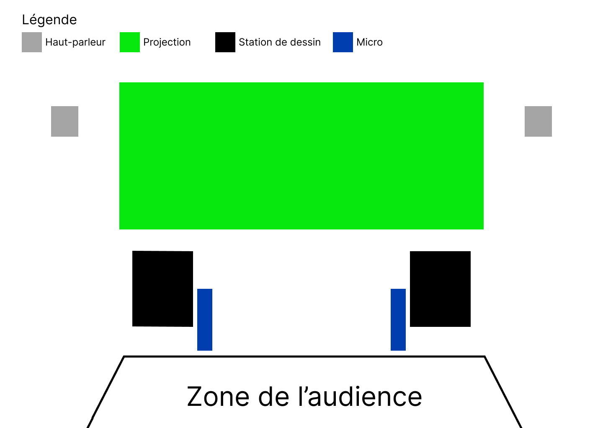
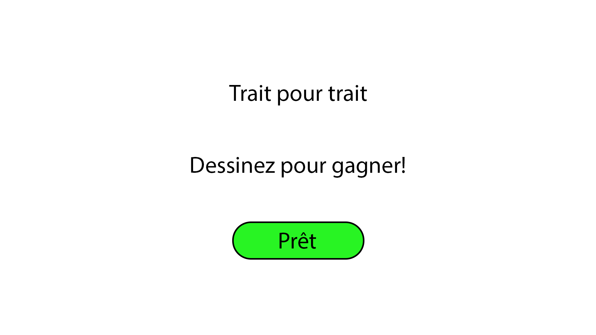
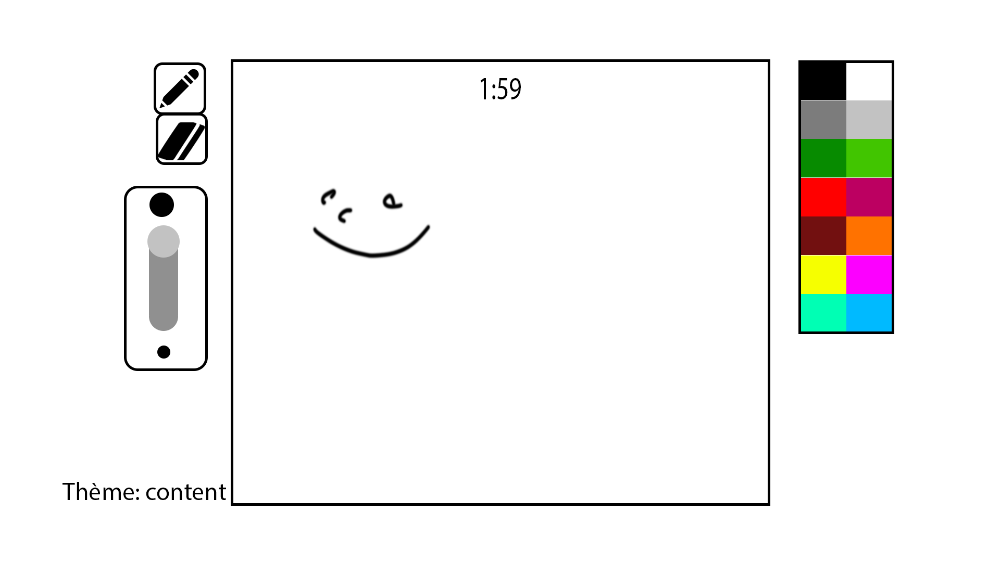
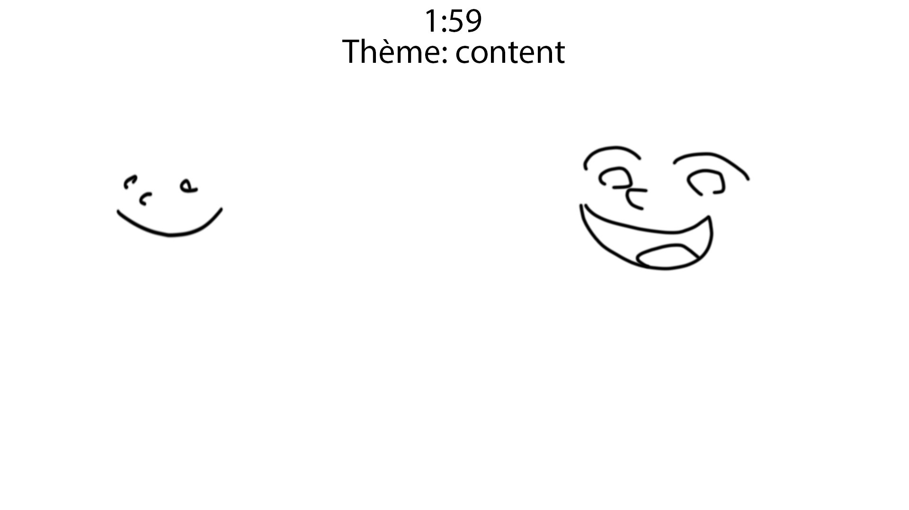
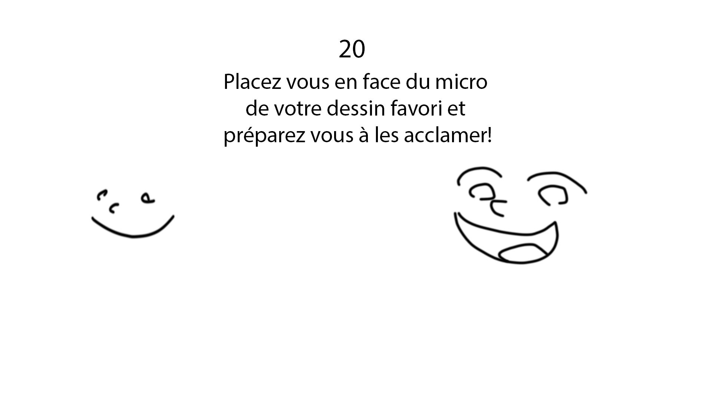
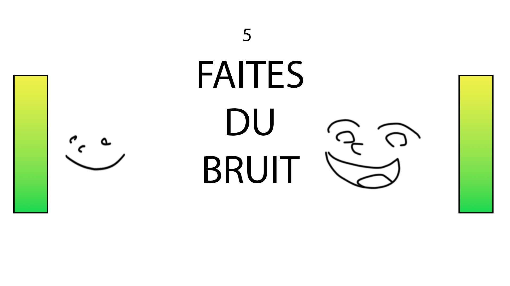
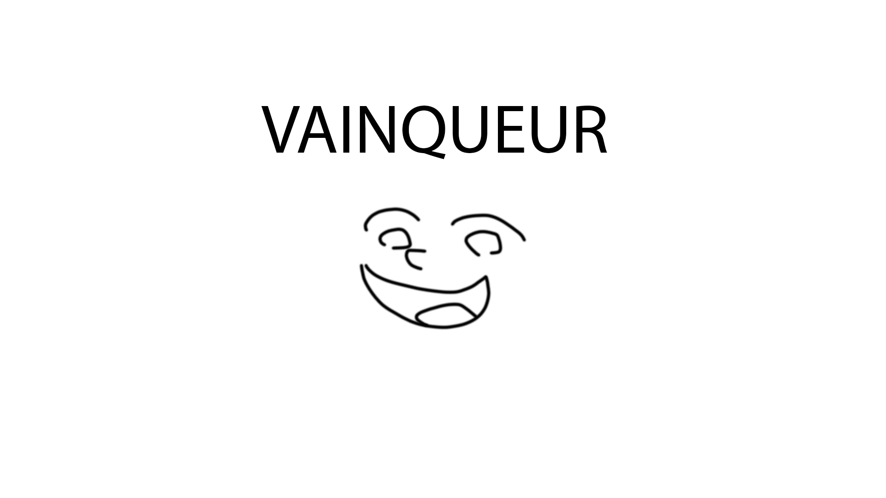

# Scénario

Cette section présente le scénario de l’interactivité du projet.

<!-- Pour chaque étape/scène : une image avec du texte descriptif et une explication de la transition -->

<!--
Éléments du scénarimage
Séquence visuelle
Chaque scène ou séquence du scénarimage doit être clairement illustrée, montrant les éléments visuels qui seront projetés ou affichés. Cette séquence visuelle peut inclure des captures d'écran, des croquis ou des rendus 3D, en fonction des besoins du projet.

Points d'interaction
Le scénarimage dans un cadre interactif inclut les moments où l'utilisateur interagit avec l'installation. Ces points d’interaction doivent être représentés graphiquement pour indiquer comment et quand l’utilisateur influencera la progression du récit ou des effets visuels et sonores.

Évolution du récit
Comme pour le scénario narratif, le scénarimage doit montrer la progression de l’histoire ou de l’expérience au fil des interactions. Il permet de visualiser comment l’installation évolue en fonction des actions de l'utilisateur, avec des embranchements possibles selon ses choix.

Retour visuel et sensoriel
Le scénarimage doit inclure des annotations ou des vissuels montrant les réponses visuelles, sonores ou tactiles à chaque interaction. Cela peut inclure des changements d’éclairage, des transitions vidéo, ou des effets sonores qui réagissent aux actions de l’utilisateur.
-->

## Scène 1 : Arrivée à l'installation

**Ce que l’interacteur voit :**
- L'écran projeté montrant des dessins qui défilent
- Deux stations de dessins illuminées faisant face à l'audience (table - tablette graphique)
- La zone délimité pour l'audience
- Deux microphones 

**Ce que l’interacteur entend :**
- Musique d'ambiance 

## Scène 2 : Menu principal  (virtuel)

**Ce que l’interacteur voit :**
- Bouton "*prêt*"
- Titre de l'oeuvre  
- Slogan de l'oeuvre

**Ce que l’interacteur entend :**
- Musique d'ambiance (menu)

### Tableau des actions
| Verbe d’action | Condition / contexte | Effet visuel | Effet sonore | Effet interactif |
| -- | -- | -- | -- | -- |
|  Appuyer sur le bouton via la tablette graphique   |  Menu principal   | Changement du fond d'écran    |   Son de confirmation  |  Confirmation de la présence du joueur. Si les boutons des deux stations sont appuyés -> début du jeu   |

## Scène 3 : Interface de jeu (virtuel)

**Ce que l’interacteur voit :** 
- Roulette des thèmes des dessins
- Décompte de 3, 2 et  1 
- Canva 
- Option de couleur 
- Gomme à effacer
- Chronomètre affichant 2 minutes
- Contrôleur d'épaisseur 

**Ce que l’interacteur entend :**
- Bruit du décompte 
- Musique d'ambiance (jeux)
- Alerte du chronomètre au 3/4 du temps (1 min 30 )
- Musique d'ambiance accéléré (jeux)
- Tic pour les 10 dernières secondes

### Tableau des automatisations
| Déclenchement | Effet visuel | Effet sonore | Effet interactif |
| -- | -- | -- | -- |
|  Entrée de la scène   |  Roulette qui tourne   |  Son de roulette   |   Définition du thème du dessin  |
|  Fin du chronomètre   |  Apparition de la scène 4   |  Son d'alerte   |   Blocage de l'espace de dessin  |

### Tableau des actions
| Verbe d’action | Condition / contexte | Effet visuel | Effet sonore | Effet interactif |
| -- | -- | -- | -- | -- |
|   Tracer sur le canva via la tablette graphique  |   Selon le thème défini  |   Gravure du trait sur le canva  |  N/A   |   Modification du dessin  |
|   Appuyer sur un cercle de couleur via la tablette graphique  |   Pendant le dessinage  |   Bordure verte autour de la couleur  |  Petit effet sonore de sélection  |   Changement de la couleur des futurs traits  |

## Scène 3.5 : Dessin en temps réel POV audience (virtuel)

**Ce que l’interacteur voit :**
- Roulette des thèmes des dessins
- Chronomètre affichant 2 minutes 
- Les dessins des joueurs en temps réel

**Ce que l’interacteur entend :**
- Bruit du décompte 
- Musique d'ambiance (jeux)
- Alerte du chronomètre au 3/4 du temps (1 min 30 )
- Musique d'ambiance accéléré (jeux)
- Tic pour les 10 dernières secondes

## Scène 4 : Préparation au vote (virtuel)

**Ce que l’interacteur voit :**
- Instructions du vote
- Les dessins des joueurs 
- Chronomètre de 20 secondes 

**Ce que l’interacteur entend :**
- Musique d'ambiance (vote)
- Alerte des 3 dernières secondes

### Tableau des automatisations
| Déclenchement | Effet visuel | Effet sonore | Effet interactif |
| -- | -- | -- | -- |
|  Fin du chronomètre   |  Apparition de la scène 5   |  Fin de la musique   |   Changement de scène  |

### Tableau des actions
| Verbe d’action | Condition / contexte | Effet visuel | Effet sonore | Effet interactif |
| -- | -- | -- | -- | -- |
|  L'audience se déplace vers un des deux micros   |   Avant le vote  |  N/A   |  N/A   |   N/A  |

## Scène 5 : Vote (virtuel)

**Ce que l’interacteur voit :**
- Instruction
- Jauge de volume
- Chronomètre de 5 secondes
- Les dessins des joueurs 

**Ce que l’interacteur entend :**
- Encouragement de l'audience

### Tableau des automatisations
| Déclenchement | Effet visuel | Effet sonore | Effet interactif |
| -- | -- | -- | -- |
|  Fin du chronomètre   |  Apparition de la scène 6   |  N/A   |   Changement de scène  |

### Tableau des actions
| Verbe d’action | Condition / contexte | Effet visuel | Effet sonore | Effet interactif |
| -- | -- | -- | -- | -- |
|  Acclamer en direction du micro représentant le dessin voté  |   Durant le vote, par l'audience  |   Changement de la barre de volume  |  N/A   |   Hausse du volume moyen   |

## Scène 6 : Résulat (virtuel)

**Ce que l’interacteur voit :**
- Texte "*Vainqueur*"
- Dessin du vainqueur

**Ce que l’interacteur entend :**
- Musique d'ambience (victoire)
